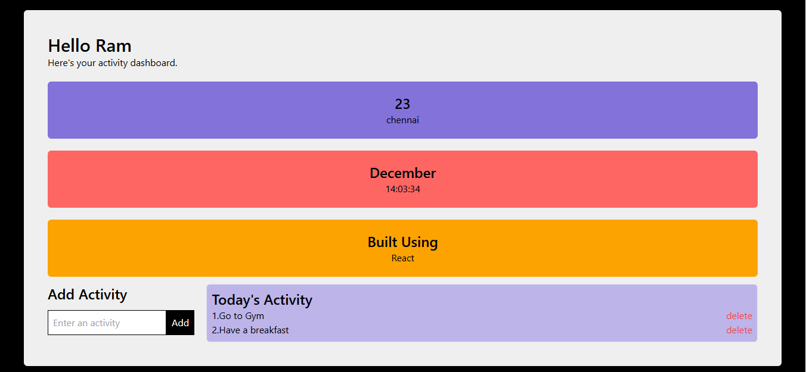

# Actodo — Activity & Task Management Dashboard


A single-page task and activity management app built with **React**, **React Router**, and **Tailwind CSS**. Actodo demonstrates a client-side login/signup flow, passing user data between routes, and add/delete state management in a modular component structure.

🔗 **[View Live Demo](https://actodo-react-app-kk7n.vercel.app/)**

---

## 📸 Application Preview



---

## ✨ Key Features

- **Client-Side Authentication Flow:** User registration (`/signUp`) and login (`/`) with error feedback for unregistered accounts.
- **Multi-Page SPA Routing:** Client-side navigation using `react-router-dom` (`BrowserRouter`, `Routes`, `Route`).
- **Route State Transfer:** Passes the logged-in username to the dashboard with `useNavigate` and `useLocation` for a personalized greeting.
- **Interactive Task Management:** Add and delete daily activities using `useState` and immutable array updates (`filter` and spread syntax).
- **Modular Component Architecture:** Page-level views (`Login`, `SignUp`, `Landing`) and reusable components (`Header`, `Card`, `TodoContainer`, `TodoAdd`, `TodoList`, `TodoItem`).
- **Responsive Layout:** Tailwind CSS flexbox layout with color-coded summary cards.

---

## 🛠️ Tech Stack

- React
- React Router DOM
- Tailwind CSS
- JavaScript (ES6+)

---

## 🏗️ Project Architecture

```text
src/
|── assets/
├── components/
│   ├── Card.jsx            # Reusable info summary card
│   ├── Header.jsx          # Personalized dashboard header
│   ├── TodoAdd.jsx         # Controlled input for creating tasks
│   ├── TodoContainer.jsx   # Parent state container for activities
│   ├── TodoItem.jsx        # Single task row with delete handler
│   └── TodoList.jsx        # Renders the list of tasks
├── pages/
│   ├── Landing.jsx         # Dashboard view after login
│   ├── Login.jsx           # Login and validation view
│   └── SignUp.jsx          # New user registration view
├── App.js                  # Root router and shared user state
├── index.js                # React entry point
└── index.css              
```

---

## 🚀 Getting Started

```bash
git clone https://github.com/<your-username>/<your-repo>.git
cd <your-repo>
npm install
npm start
```

The app runs at `http://localhost:3000`.

**Demo login:** username `Inthusha`, password `123` (or create an account on the Sign Up page).

---

## ⚠️ Known Limitations

- Users are stored in React state only, so accounts reset on page refresh.
- Passwords are stored in plain text. This is for learning only, not production use.
- The dashboard has no route guard, so it should be reached through the login page.
- Tasks are not saved between sessions.

---
